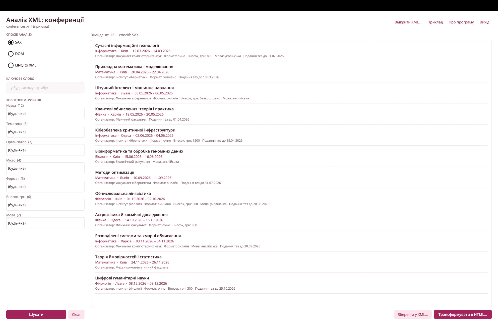

# Лабораторна робота №2: "Робота з XML-файлами"

##  Основний функціонал

* **Відкриття XML:** Файл відкривається через системний діалог, або можна взяти вбудований приклад `conferences.xml`.
* **Підгрузка даних:** Для кожного атрибута вузлів `<Conference>` будується випадний список зі значень, які реально є у файлі.
* **Пошук:** За ключовим словом (у будь-якому атрибуті, без урахування регістру) та за точними значеннями атрибутів. Без критеріїв показуються всі конференції.
* **Три способи аналізу:** Користувач обирає спосіб перемикачем, результат у всіх однаковий:
    * **SAX:** послідовне читання файлу через `XmlReader`.
    * **DOM:** дерево `XmlDocument` і динамічно згенерований запит XPath.
    * **LINQ to XML:** `XDocument` і ланцюжок `Where`.
* **Clear:** Очищає результати й задані параметри пошуку.
* **Збереження:** Результати пошуку можна зберегти у XML-файл того самого формату.
* **Трансформація в HTML:** Результати перетворюються в HTML за XSL-документом (вбудованим або обраним користувачем).
* **Вихід:** Програма питає підтвердження «Чи дійсно ви хочете завершити роботу з програмою?».

##  Реалізація (Варіант 20: "Конференції")

Кожна конференція — вузол `<Conference>` з атрибутами `title`, `topic`, `organizer`, `city`, `format`, `fee`, `language` (кількість атрибутів у різних вузлах різна) і дочірніми елементами `<Dates>` та `<SubmissionDeadline>`.

Способи аналізу реалізовано шаблоном **«Стратегія»**:

* **Інтерфейс:** `IXmlSearchStrategy` з методом `Search(path, criteria)`
* **Стратегії:** `SaxSearchStrategy`, `DomSearchStrategy`, `LinqSearchStrategy`
* **Контекст:** `XmlSearchContext` зберігає обрану стратегію і викликає її
* **Клієнт:** `MainViewModel` передає контексту стратегію, обрану користувачем

##  Використані технології

* **Мова:** C#
* **Платформа:** .NET MAUI (macOS, Windows)
* **XML:** `XmlReader`, `XmlDocument` + XPath, LINQ to XML, `XslCompiledTransform`
* **Тести:** xUnit

